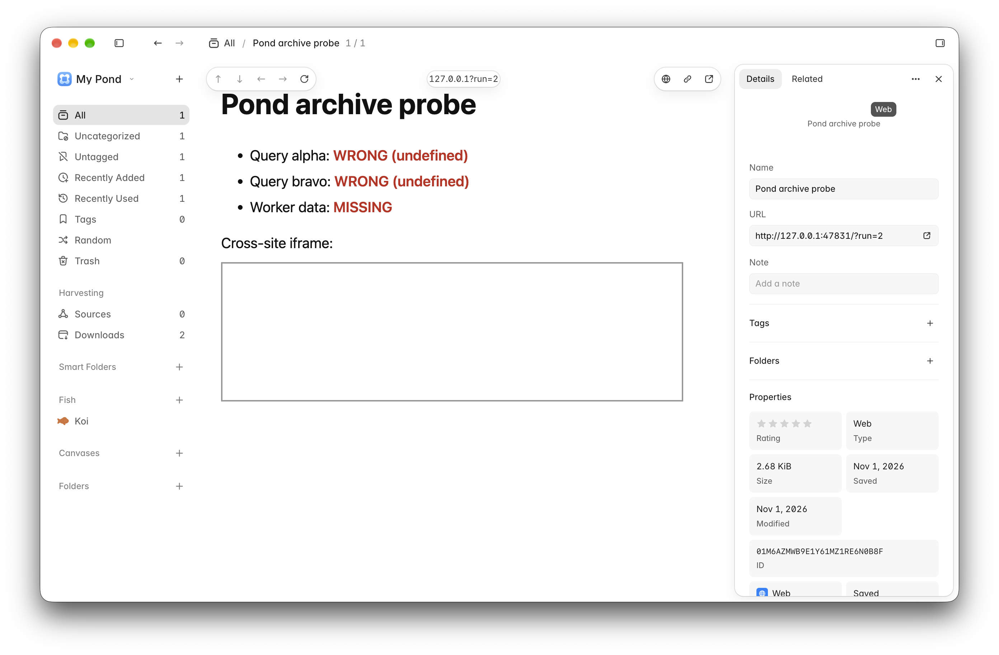
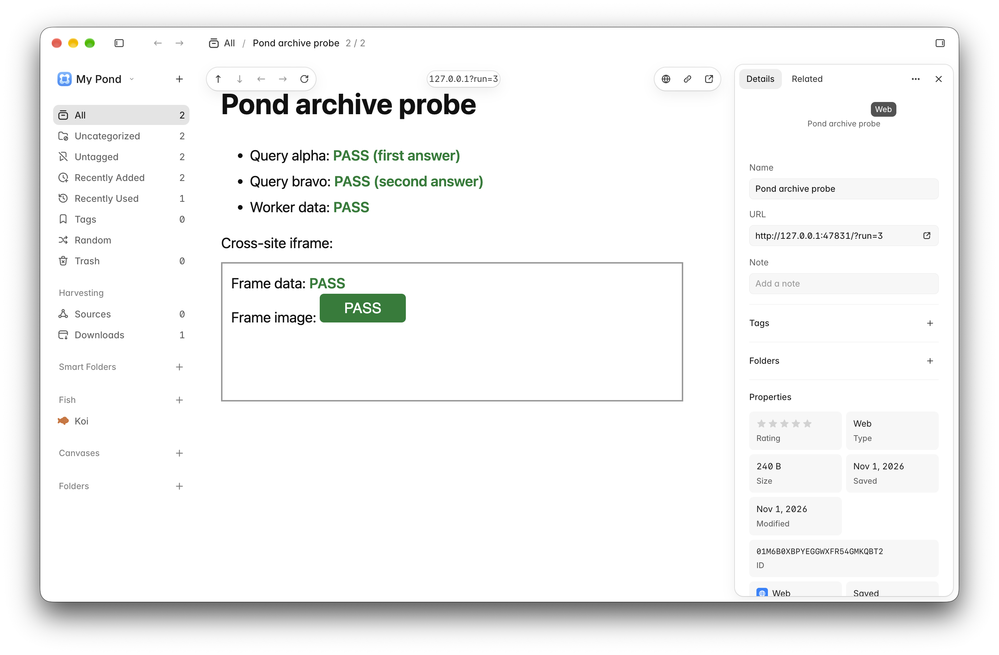

# Page archiving: where it stands and what's next

Written 2026-11-01. Code: branch `fix/archive-recorder` on `Shahfarzane/pond`, six commits on top of upstream `main` at 2.2.0 (`60b40a9a`). No PR yet. Tools to reproduce everything below: [tools/archive-probe](../../tools/archive-probe/README.md).

## How Pond archives a page today

The browser extension sends Pond only the URL and the tab's cookies. Pond then loads the page a second time in a hidden Electron window, records that visit's network traffic into a WARC through the DevTools protocol, and replays it with wabac.js at `pond://replay`. Everything that goes wrong comes from that second visit or from how it is recorded and replayed.

## What the branch fixes

| Commit | Change |
| --- | --- |
| `8bb43c15` | Refactor: the recorder talks to Chromium through a small `CdpTarget` interface, so tests can drive it with a fake. |
| `ef2af719` | Records cross-site iframes and workers (auto-attached sessions) and keeps every POST by method, URL and body, with a request record so wabac.js can replay GraphQL calls. |
| `f90e240a` | Waits up to 15 s for a bot check that reloads into the page (metadata render and archive crawl), and lets the real page replace the check page in the WARC. |
| `7a88aa25` | When tab cookies land the crawl on a sign-in form, logs it and archives once without them. |
| `28b1c446` | Bumps `ARCHIVE_VERSION` so the backfill can redo old archives. Droppable if the maintainer prefers. |
| `ccd6aa7c` | Moves replay from `pond://_replay` to `pond://replay`. wabac's CSP lists its own origin in `frame-src`, Chromium rejects a host with an underscore, so every iframe in every archive was blocked. |

Verified:

- New tests fail on the old code and pass now: recorder (6), bot-check wait (5), cookie fallback (4), replay host (1). `pnpm check` passes apart from `view-store-persistence.test.ts`, which flakes under full load and passes on its own.
- The probe page archived by Pond 2.2.0 fails all four checks; archived by a signed build of the branch it passes all four, replayed with the site offline.

| Pond 2.2.0 | This branch |
| --- | --- |
|  |  |

- A notarized test copy with its own app group receives Safari saves and archives them.

## Still failing: sites behind Cloudflare's bot check

Product Hunt is the known case. In the hidden window, Cloudflare shows "Just a moment… Performing security verification" and keeps it there; no checkbox, no pass, 16 s watched. `harvest_metadata` then fails with `web render 403`, which is terminal and also marks `archive_page` as blocked, so the save ends with nothing. The user's own tab passed the same check, but Pond never uses that tab.

Waiting longer does not help. Making the hidden window look more like a normal browser would be evading bot detection and would break again whenever Cloudflare changes; not worth building.

## Next step 1: capture from the tab

Use what the user's browser already loaded instead of visiting again.

**Metadata from the tab (small, fixes the dead save).** The extension sends title, description, image, canonical URL and favicon with the save. `harvest_metadata` uses them when present, so a 403 from the re-visit no longer kills the save.

- `packages/schema/src/ingest.ts`: optional page metadata on `enqueueRequestSchema`, parsed with size caps (it is page-controlled input).
- `apps/extension/entrypoints/background/capture.ts`: read it from the active tab with `scripting.executeScript` (permission already granted).
- `apps/desktop/src/main/core/pipeline/extractors/sources/web.ts`: prefer the tab's metadata, fall back to fetch and render.

**Snapshot from the tab (the archive).** The extension serializes every frame's DOM into one self-contained HTML file: CSS, images and fonts inlined, shadow DOM flattened, canvases turned into images, form values kept. Pond stores it as a new save file kind and shows it in a sandboxed viewer with scripts off.

Decisions to make:

- **When to use it.** Only as a fallback (403, sign-in page, nothing captured), or always for single-page saves with the WARC crawl kept for Archive Site.
- **Format.** Own serializer (works in Chrome and Safari; SingleFile does this well but is AGPL and Pond is MIT) or `chrome.pageCapture.saveAsMHTML` (one call, Chrome only, needs a new permission, and Electron rendering MHTML from `pond://` is unverified).
- **Size and transport.** Snapshots can reach tens of MB. Chrome saves go to Pond's local HTTP server; Safari saves go through native messaging and the app group socket, whose message size limit needs checking.

## Next step 2: upstream PR for the recorder branch

Draft the PR from the table above with the before/after screenshots. Points for the maintainer:

- The `ARCHIVE_VERSION` bump is its own commit and can be dropped.
- The replay host rename gives wabac a new origin, so each archive is indexed again on first view and the old origin's storage is left unused.
- The recorder pauses each new iframe and worker until capture is on, then resumes it. Tests use a fake Chromium; real Electron behaviour was checked by hand with the probe page.

## Other follow-ups found on the way

- Any terminal `harvest_metadata` failure blocks `archive_page`. The archive, which carries the tab's cookies, might still succeed on some of those sites.
- Test builds under a deep worktree path cannot bind the Chrome native socket (`listen EINVAL`, path too long). Only affects sandboxed test copies.
- `view-store-persistence.test.ts` flakes under load (already tracked separately).
- Large area screenshots fail with "too large" (already tracked separately).
- The offline save queue prototype (save from the browser while Pond is closed) is on branch `proto/offline-inbox`, five commits, not reviewed for a PR yet.
- The main checkout has no `node_modules`; run `pnpm install` there before the next `pnpm dev`.
